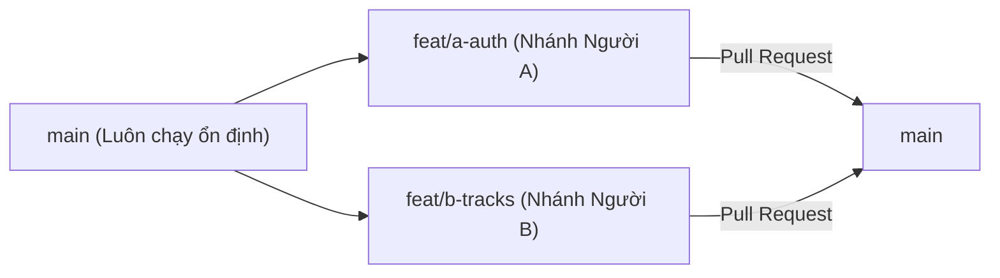

# Hướng Dẫn Quy Trình Git, Phân Chia Công Việc & Quy Tắc Code (Nhóm 2 Người)

Tài liệu này quy định cách **Người A** và **Người B** phối hợp trên GitHub để **không bao giờ bị xung đột code (Git Merge Conflict)** và giữ chất lượng code đồng nhất.

---

## 1. Nguyên Tắc Cốt Lõi Để Không Bị Conflict

1. **Không chia việc theo tầng ngang** (không phải 1 người viết hết `models/schemas`, 1 người viết hết `routers/services`).
2. **Chia việc theo "Lát cắt dọc" (Vertical Slice):**
   * Đầu tiên, dựng xong **Phần Chung (Giai đoạn 0)** gồm kết nối DB, 9 class Model SQLAlchemy và khung `main.py` rồi merge vào `main`.
   * Sau đó, **Người A** và **Người B** làm việc trên **2 tập file hoàn toàn tách biệt** (`schemas/`, `services/`, `routers/`, `tests/`).

---

## 2. Bảng Phân Vùng Lãnh Thổ File (File Ownership Matrix)

Mỗi file trong dự án đã được gắn nhãn ở ngay dòng đầu tiên (`[PHẦN CHUNG]`, `[NGƯỜI A]`, hoặc `[NGƯỜI B]`):

### 🔒 Vùng 0: `[PHẦN CHUNG]` (Dựng ở Giai đoạn 0 – Hạn chế sửa sau khi đã chốt)
| Đường dẫn file | Nhiệm vụ | Quy tắc khi cần sửa |
| :--- | :--- | :--- |
| `app/main.py` | Khởi tạo `FastAPI()`, `include_router` cho cả 6 router | Đã đăng ký sẵn 6 router từ đầu. Nếu cần sửa, nhắn người kia trước khi sửa. |
| `app/deps.py` | `get_db()`, `get_current_user()`, `require_admin()` | Hoàn thiện ở bước đầu tiên để cả 2 cùng gọi qua `Depends(...)`. |
| `app/core/config.py`<br>`app/core/security.py` | Đọc biến `.env`, băm mật khẩu `bcrypt`, tạo/giải mã JWT | Dùng chung, không tự ý đổi tên hàm. |
| `app/db/base.py`<br>`app/db/session.py` | `DeclarativeBase`, `engine`, `SessionLocal` | Không sửa sau khi kết nối PostgreSQL thành công. |
| `app/models/*.py` | 9 class ORM ánh xạ 9 bảng PostgreSQL | Khớp cố định với 9 bảng DB đã tạo. |
| `app/schemas/common.py`<br>`app/services/base.py` | `PaginatedResponse[T]` và lớp cha `BaseService` | Cả 2 cùng kế thừa và tái sử dụng. |

---

### 👤 Vùng 1: `[NGƯỜI A]` — Tài Khoản, Phân Quyền, Playlist & Chatbot Groq
Người A toàn quyền chỉnh sửa các file sau mà không lo đụng tới Người B:

| Tầng | Các file của Người A | Use Cases phụ trách |
| :--- | :--- | :--- |
| **Schemas** | • `app/schemas/auth.py`<br>• `app/schemas/user.py`<br>• `app/schemas/playlist.py`<br>• `app/schemas/chatbot.py` | • **Auth & Cá nhân:** `UC-01` (Đăng ký), `UC-02` (Đăng nhập), `UC-05` (Xem profile)<br>• **Quản trị User:** `UC-16` (Xem DS user, đổi role, khóa/mở khóa)<br>• **Playlist & Kiểm duyệt:** `UC-06..UC-11`, `UC-17`<br>• **Chatbot AI:** `UC-12` (Tạo playlist bằng Groq API) |
| **Services** | • `app/services/auth_service.py` (`AuthService`)<br>• `app/services/user_service.py` (`UserService`)<br>• `app/services/playlist_service.py` (`PlaylistService`)<br>• `app/services/chatbot_service.py` (`ChatbotService`, `GroqClient`) | Thực thi các quy tắc: `BR-01`, `BR-02`, `BR-03`, `BR-05`, `BR-06`, `BR-07`, `BR-08`, `BR-09`, `BR-10`, `BR-11` |
| **Routers** | • `app/routers/auth.py` (`/api/v1/auth`)<br>• `app/routers/users.py` (`/api/v1/users`)<br>• `app/routers/playlists.py` (`/api/v1/playlists`) | 15 Endpoints thuộc nhóm Auth, Users, Playlists & Chatbot |
| **Tests** | • `tests/test_auth.py`<br>• `tests/test_users.py`<br>• `tests/test_playlists.py`<br>• `tests/test_chatbot.py` | Kiểm thử đơn vị & tích hợp cho các API của Người A |

---

### 👤 Vùng 2: `[NGƯỜI B]` — Bài Hát, Danh Mục (Nghệ Sĩ, Album, Thể Loại) & Lịch Sử Nghe
Người B toàn quyền chỉnh sửa các file sau mà không lo đụng tới Người A:

| Tầng | Các file của Người B | Use Cases phụ trách |
| :--- | :--- | :--- |
| **Schemas** | • `app/schemas/track.py`<br>• `app/schemas/catalog.py`<br>• `app/schemas/history.py` | • **Bài hát:** `UC-03` (Tìm kiếm, lọc, sắp xếp, phân trang, chi tiết), `UC-14` (Admin thêm, sửa, xóa bài hát)<br>• **Danh mục:** `UC-04` (Xem nghệ sĩ, album, thể loại, định dạng), `UC-15` (Admin CRUD nghệ sĩ, album, thể loại)<br>• **Lịch sử nghe:** `UC-13` (Ghi nhận & xem 20 bài nghe gần nhất) |
| **Services** | • `app/services/track_service.py` (`TrackService`)<br>• `app/services/catalog_service.py` (`CatalogService`)<br>• `app/services/history_service.py` (`HistoryService`) | Thực thi quy tắc `BR-04` (chặn xóa danh mục đang có bài hát tham chiếu; xóa bài hát tự gỡ khỏi playlist) |
| **Routers** | • `app/routers/tracks.py` (`/api/v1/tracks`)<br>• `app/routers/catalog.py` (`/api/v1/artists`, `/albums`, `/genres`, `/media-types`)<br>• `app/routers/history.py` (`/api/v1/me/history`) | 20 Endpoints thuộc nhóm Tracks, Catalog & Listening History |
| **Tests** | • `tests/test_tracks.py`<br>• `tests/test_catalog.py`<br>• `tests/test_history.py` | Kiểm thử đơn vị & tích hợp cho các API của Người B |

---

## 3. Quy Trình Git & Merge 5 Bước Hàng Ngày (GitHub Flow)



### Quy tắc số 1: KHÔNG BAO GIỜ code trực tiếp hoặc push thẳng lên nhánh `main`!

Mỗi khi bắt đầu làm một chức năng mới, hãy làm đúng **5 bước** sau:

#### Bước 1: Kéo code mới nhất từ `main` về máy
```bash
git checkout main
git pull origin main
```

#### Bước 2: Tạo nhánh riêng cho chức năng đang làm
Đặt tên nhánh theo mẫu: `feat/a-<ten-chuc-nang>` (cho Người A) hoặc `feat/b-<ten-chuc-nang>` (cho Người B).
```bash
# Ví dụ cho Người A làm chức năng Auth:
git checkout -b feat/a-auth

# Ví dụ cho Người B làm chức năng tìm kiếm bài hát:
git checkout -b feat/b-tracks-read
```

#### Bước 3: Code trong các file được phân công & Commit nhỏ gọn
Chỉ `git add` những file mình sửa (tuyệt đối kiểm tra `git status` trước khi commit):
```bash
git status
git add app/schemas/track.py app/services/track_service.py app/routers/tracks.py
git commit -m "feat(tracks): cài đặt API tìm kiếm và phân trang bài hát (UC-03)"
```
*Quy ước tiền tố commit:*
* `feat(...)`: Thêm tính năng / API mới.
* `fix(...)`: Sửa lỗi.
* `test(...)`: Thêm hoặc sửa pytest / Postman.
* `docs(...)`: Cập nhật tài liệu.

#### Bước 4: Đẩy nhánh lên GitHub & Tạo Pull Request (PR)
```bash
git push -u origin feat/b-tracks-read
```
Sau đó mở trang GitHub của repo $\rightarrow$ Bấm **Compare & pull request** $\rightarrow$ Điền checklist có sẵn và bấm **Create pull request**.

#### Bước 5: Review chéo & Merge
* Báo cho người còn lại vào xem Pull Request (việc đọc PR của nhau giúp cả 2 đều nắm rõ toàn bộ hệ thống khi thầy hỏi vấn đáp).
* Sau khi bấm **Merge pull request** trên GitHub, quay lại máy cá nhân kéo `main` mới nhất về để làm tính năng tiếp theo (quay lại Bước 1).

---

## 4. Quy Tắc Code Thống Nhất (Coding Rules)

Để code của Người A và Người B ráp vào nhau như một người viết:

1. **Bắt buộc thiết kế theo Hướng đối tượng (OOP):**
   * Mọi logic nghiệp vụ phải viết thành phương thức (method) bên trong class kế thừa từ `BaseService` (ví dụ `class TrackService(BaseService):`).
   * Router chỉ làm 3 việc: nhận tham số HTTP + `db: Session = Depends(get_db)`, khởi tạo Service (`service = TrackService(db)`), và trả kết quả.
2. **Xử lý lỗi thống nhất bằng `HTTPException` của FastAPI:**
   * Khi vi phạm quy tắc nghiệp vụ (`401`, `403`, `404`, `409`, `422`, `429`), ném trực tiếp `HTTPException(status_code=status.HTTP_..., detail="Thông báo tiếng Việt có dấu")` ngay trong tầng `Service`.
3. **Không bao giờ trả thẳng Model nhạy cảm:**
   * Luôn khai báo `response_model=...` trên mỗi decorator `@router.get(...)`, `@router.post(...)` để Pydantic lọc dữ liệu đầu ra (đặc biệt là ẩn `password_hash`).
4. **Chia nhỏ Pull Request:**
   * Đừng đợi code xong toàn bộ phần của mình mới tạo 1 Pull Request khổng lồ. Hãy chia thành 2–3 PR nhỏ (ví dụ: PR 1 làm xong `Auth`, merge xong rồi mới tạo nhánh làm PR 2 cho `Playlist`).
