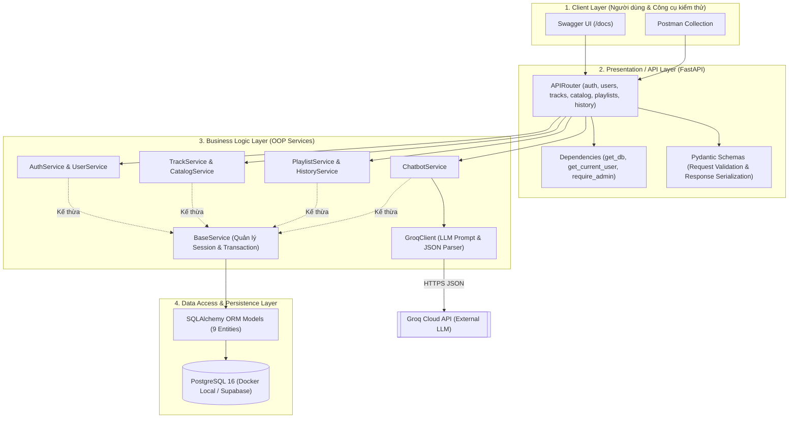
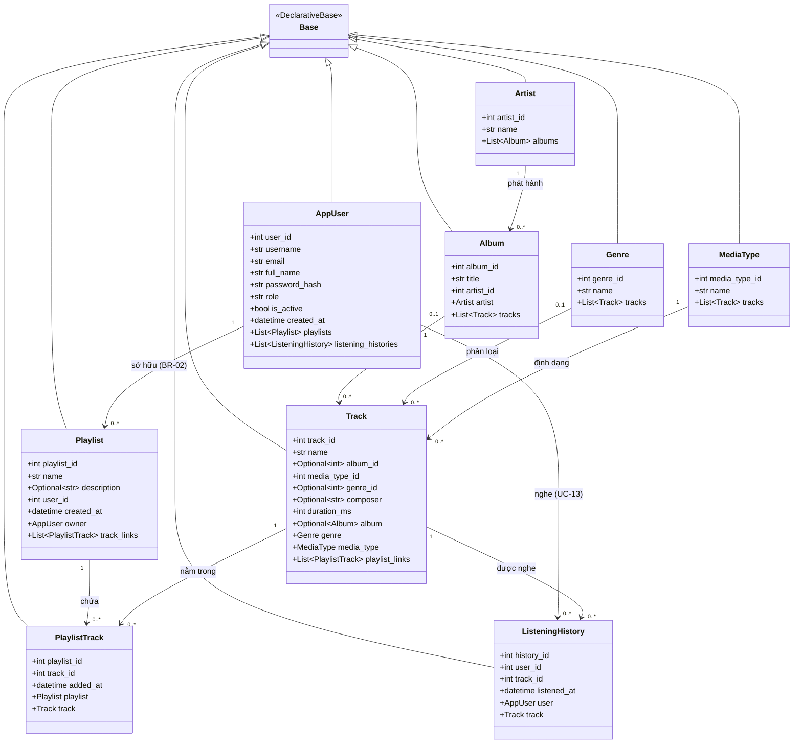

# TÀI LIỆU THIẾT KẾ HỆ THỐNG (SYSTEM DESIGN)
**Hệ thống Quản lý Âm nhạc qua RESTful API**  
*Công nghệ: Python • FastAPI • SQLAlchemy 2.0 • PostgreSQL 16 (Docker / Supabase) • Groq API*

---

## 1. Thiết kế Kiến trúc (System Architecture)

### 1.1. Kiến trúc Phân tầng (Layered Architecture)
Hệ thống được thiết kế theo kiến trúc **4 tầng (4-Tier Layered Architecture)** tách biệt rõ trách nhiệm giữa giao diện API, xử lý nghiệp vụ hướng đối tượng, ánh xạ dữ liệu ORM và hệ quản trị cơ sở dữ liệu PostgreSQL:



**Vai trò và giới hạn của từng tầng:**
| Tầng | Trách nhiệm chính | Nguyên tắc thiết kế |
| :--- | :--- | :--- |
| **1. Router (`app/routers/`)** | Định nghĩa đường dẫn HTTP (`GET`, `POST`, `PUT`, `DELETE`), gắn Dependency xác thực/phân quyền, gọi phương thức của lớp `Service` và trả về `Pydantic Schema`. | Không viết câu lệnh truy vấn SQL/ORM trực tiếp trong Router. |
| **2. Schema (`app/schemas/`)** | Kiểm tra dữ liệu đầu vào (độ dài mật khẩu $\ge 8$, tên playlist $1..100$ ký tự, `page >= 1`...) và lọc dữ liệu đầu ra (loại bỏ `password_hash` theo `NFR-01`). | Tách biệt class `*Create` / `*Update` (đầu vào) và `*Response` (đầu ra). |
| **3. Service (`app/services/`)** | Thiết kế theo **Hướng đối tượng (OOP)**: kế thừa từ `BaseService`, kiểm tra các quy tắc nghiệp vụ (`BR-01` $\rightarrow$ `BR-11`) và ném `fastapi.HTTPException` chuẩn khi vi phạm. | Mỗi miền nghiệp vụ là một class độc lập, nhận `db: Session` qua hàm khởi tạo `__init__`. |
| **4. Model (`app/models/`)** | Ánh xạ 1-1 với **9 bảng PostgreSQL** qua SQLAlchemy `DeclarativeBase`, khai báo khóa chính, khóa ngoại và các `relationship`. | Chỉ biểu diễn cấu trúc dữ liệu và quan hệ thực thể. |

---

### 1.2. Cấu trúc Thư mục Dự án & Phân chia Module cho Nhóm 2 Người

Để hai thành viên làm việc song song trên GitHub mà **không bị xung đột file (Zero-conflict)**, phần khung dùng chung (`core/`, `db/`, `models/`, `main.py`) được khởi tạo ở **Giai đoạn 0**, sau đó tách file theo từng miền nghiệp vụ:

```text
project/
├── app/
│   ├── main.py                  # [Chung - GĐ0] Khởi tạo FastAPI, đăng ký sẵn các Router
│   ├── deps.py                  # [Chung - GĐ0] get_db, get_current_user, require_admin
│   ├── core/
│   │   ├── config.py            # [Chung - GĐ0] Class Settings đọc biến môi trường (.env)
│   │   └── security.py          # [Chung - GĐ0] Hash mật khẩu bcrypt, tạo/giải mã JWT
│   ├── db/
│   │   ├── base.py              # [Chung - GĐ0] Class Base (DeclarativeBase)
│   │   └── session.py           # [Chung - GĐ0] Engine PostgreSQL & SessionLocal
│   ├── models/                  # [Chung - GĐ0] 9 class SQLAlchemy ORM ánh xạ 9 bảng
│   │   ├── __init__.py
│   │   ├── user.py              # AppUser
│   │   ├── catalog.py           # Artist, Album, Genre, MediaType, Track
│   │   ├── playlist.py          # Playlist, PlaylistTrack
│   │   └── history.py           # ListeningHistory
│   ├── schemas/                 # [Tách theo người] Pydantic DTOs
│   │   ├── common.py            # [Chung] PaginatedResponse[T]
│   │   ├── auth.py              # [Người A]
│   │   ├── user.py              # [Người A]
│   │   ├── playlist.py          # [Người A]
│   │   ├── chatbot.py           # [Người A]
│   │   ├── track.py             # [Người B]
│   │   ├── catalog.py           # [Người B]
│   │   └── history.py           # [Người B]
│   ├── services/                # [Tách theo người] Các lớp xử lý nghiệp vụ OOP
│   │   ├── base.py              # [Chung] BaseService
│   │   ├── auth_service.py      # [Người A] AuthService
│   │   ├── user_service.py      # [Người A] UserService
│   │   ├── playlist_service.py  # [Người A] PlaylistService
│   │   ├── chatbot_service.py   # [Người A] ChatbotService & GroqClient
│   │   ├── track_service.py     # [Người B] TrackService
│   │   ├── catalog_service.py   # [Người B] CatalogService
│   │   └── history_service.py   # [Người B] HistoryService
│   └── routers/                 # [Tách theo người] FastAPI Endpoints
│       ├── auth.py              # [Người A] /api/v1/auth
│       ├── users.py             # [Người A] /api/v1/users
│       ├── playlists.py         # [Người A] /api/v1/playlists
│       ├── tracks.py            # [Người B] /api/v1/tracks
│       ├── catalog.py           # [Người B] /api/v1/artists, /albums, /genres, /media-types
│       └── history.py           # [Người B] /api/v1/me/history
├── database/
│   ├── init/
│   │   ├── 01_chinook_original.sql
│   │   └── 02_transform_schema_and_seed.sql
│   └── README_DATABASE.md
├── tests/                       # Pytest theo từng nhóm Router
├── compose.yaml
└── .env.example
```

---

## 2. Thiết kế Hướng Đối Tượng & Sơ đồ Lớp (OOP & Class Diagrams)

### 2.1. Áp dụng các tính chất Hướng đối tượng (OOP) trong đồ án
1. **Tính Kế thừa (Inheritance):**
   * Tất cả 9 lớp thực thể CSDL (`AppUser`, `Track`, `Playlist`...) kế thừa từ lớp cơ sở `Base(DeclarativeBase)`.
   * Tất cả 7 lớp xử lý nghiệp vụ (`AuthService`, `UserService`, `TrackService`, `CatalogService`, `PlaylistService`, `HistoryService`, `ChatbotService`) kế thừa từ lớp cơ sở `BaseService` để tái sử dụng thuộc tính `self.db: Session` và các phương thức quản lý giao dịch (`_commit_and_refresh`, `_delete_and_commit`).
   * Các lớp Schema đầu ra/đầu vào kế thừa từ `pydantic.BaseModel` (ví dụ `TrackCreate` và `TrackResponse` cùng kế thừa `TrackBase`).
2. **Tính Đóng gói (Encapsulation):**
   * Kết nối CSDL (`Session`) và logic kiểm tra quyền sở hữu (`_verify_owner_or_admin`) được đóng gói bên trong các phương thức nội bộ (tiền tố `_`) của lớp Service.
   * Dữ liệu nhạy cảm (`password_hash`) nằm trong `AppUser` (ORM) nhưng bị ẩn hoàn toàn khi chuyển sang lớp `UserResponse` (DTO).
3. **Tính Hợp thành (Composition) & Tách biệt trách nhiệm:**
   * Lớp `ChatbotService` chứa một đối tượng `GroqClient` (`has-a`) để ủy quyền việc gọi API LLM bên ngoài và kiểm tra giới hạn tần suất gọi (`BR-11`), giúp dễ dàng thay thế (mock) khi chạy kiểm thử tự động mà không tốn quota Groq thật.
4. **Xử lý Ngoại lệ chuẩn Framework:**
   * Sử dụng trực tiếp lớp `HTTPException` và bộ hằng số `status` của thư viện `fastapi` để trả về mã trạng thái HTTP (`400`, `401`, `403`, `404`, `409`, `422`, `429`, `503`) kèm thông báo tiếng Việt có dấu (`NFR-05`), giúp thiết kế gọn nhẹ, không sinh thêm các class lỗi dư thừa.

---

### 2.2. Sơ đồ Lớp 1: Tầng Domain / ORM Models (9 Bảng PostgreSQL)

Sơ đồ dưới đây biểu diễn 9 lớp thực thể trong `app/models/` ánh xạ trực tiếp với 9 bảng PostgreSQL đã khởi tạo:



---

### 2.3. Sơ đồ Lớp 2: Tầng Business Logic / Services & Tích hợp Groq

Sơ đồ dưới đây biểu diễn cây kế thừa `BaseService` và các phương thức xử lý tương ứng với từng Use Case (`UC-01` $\rightarrow$ `UC-17`):

```mermaid
classDiagram
    class BaseService {
        #Session db
        +__init__(db: Session)
        #_commit_and_refresh(instance: Base) Base
        #_delete_and_commit(instance: Base) None
    }

    class AuthService {
        +register(data: UserRegisterRequest) AppUser
        +login(username: str, password: str) TokenResponse
        +get_my_profile(current_user: AppUser) AppUser
    }

    class UserService {
        +list_users(page: int, page_size: int, role: Optional~str~) PaginatedResponse
        +get_user_by_id(user_id: int) AppUser
        +update_user_status_or_role(admin: AppUser, target_id: int, data: UserAdminUpdate) AppUser
    }

    class TrackService {
        +search_tracks(q: Optional~str~, artist_id: Optional~int~, album_id: Optional~int~, genre_id: Optional~int~, sort_by: str, order: str, page: int, page_size: int) PaginatedResponse
        +get_track_detail(track_id: int) Track
        +create_track(data: TrackCreate) Track
        +update_track(track_id: int, data: TrackUpdate) Track
        +delete_track(track_id: int) None
        -_validate_foreign_keys(album_id: Optional~int~, genre_id: Optional~int~, media_type_id: int) None
    }

    class CatalogService {
        +list_artists(page: int, page_size: int, q: Optional~str~) PaginatedResponse
        +get_artist_with_albums(artist_id: int) Artist
        +create_artist(data: ArtistCreate) Artist
        +update_artist(artist_id: int, data: ArtistUpdate) Artist
        +delete_artist(artist_id: int) None
        +list_albums(page: int, page_size: int, artist_id: Optional~int~) PaginatedResponse
        +get_album_with_tracks(album_id: int) Album
        +create_album(data: AlbumCreate) Album
        +update_album(album_id: int, data: AlbumUpdate) Album
        +delete_album(album_id: int) None
        +list_genres(page: int, page_size: int) PaginatedResponse
        +create_genre(data: GenreCreate) Genre
        +update_genre(genre_id: int, data: GenreUpdate) Genre
        +delete_genre(genre_id: int) None
        +list_media_types() List~MediaType~
    }

    class PlaylistService {
        +create_playlist(user: AppUser, data: PlaylistCreate) Playlist
        +list_my_playlists(user: AppUser, page: int, page_size: int) PaginatedResponse
        +list_all_playlists_admin(user_id: Optional~int~, page: int, page_size: int) PaginatedResponse
        +get_playlist_detail(actor: AppUser, playlist_id: int) Playlist
        +update_playlist(user: AppUser, playlist_id: int, data: PlaylistUpdate) Playlist
        +delete_playlist(actor: AppUser, playlist_id: int) None
        +add_track_to_playlist(user: AppUser, playlist_id: int, track_id: int) PlaylistTrack
        +remove_track_from_playlist(user: AppUser, playlist_id: int, track_id: int) None
        -_get_and_check_access(actor: AppUser, playlist_id: int, write_mode: bool) Playlist
    }

    class ChatbotService {
        -GroqClient groq_client
        -PlaylistService playlist_service
        +__init__(db: Session, groq_client: GroqClient)
        +generate_playlist_from_prompt(user: AppUser, req: ChatbotPlaylistRequest) ChatbotPlaylistResponse
        -_check_rate_limit(user_id: int) None
        -_resolve_unique_playlist_name(user_id: int, base_name: str) str
    }

    class GroqClient {
        -str api_key
        -str model_name
        +extract_criteria(prompt: str, valid_genres: List~str~, max_tracks: int) ChatbotCriteria
    }

    class HistoryService {
        +record_listen(user: AppUser, track_id: int) ListeningHistory
        +get_recent_history(user: AppUser, limit: int) List~ListeningHistory~
    }

    BaseService <|-- AuthService
    BaseService <|-- UserService
    BaseService <|-- TrackService
    BaseService <|-- CatalogService
    BaseService <|-- PlaylistService
    BaseService <|-- ChatbotService
    BaseService <|-- HistoryService

    ChatbotService *-- GroqClient : sử dụng
    ChatbotService --> PlaylistService : phối hợp tạo playlist
```



---

### 2.4. Bảng Thiết kế các lớp Pydantic Schema (DTOs)

Các lớp trong `app/schemas/` kế thừa từ `pydantic.BaseModel` dùng để kiểm tra dữ liệu vào/ra:

| File Schema | Các Class chính | Ràng buộc kiểm tra (Validation) & Ghi chú |
| :--- | :--- | :--- |
| `common.py` | `PaginatedResponse[T]` | Generic Schema gồm: `items: List[T]`, `total: int`, `page: int`, `page_size: int`. |
| `auth.py` | `UserRegisterRequest`, `TokenResponse` | `username` (3..50 ký tự), `email` (`EmailStr`), `password` ($\ge 8$ ký tự theo `BR-09`). Không nhận trường `role` (`BR-01`). |
| `user.py` | `UserResponse`, `UserAdminUpdate` | `UserResponse` chỉ trả `user_id, username, email, full_name, role, is_active, created_at` (ẩn `password_hash` theo `NFR-01`). `UserAdminUpdate` nhận `role` (`'user'\|'admin'`) và `is_active` (`bool`). |
| `track.py` | `TrackCreate`, `TrackUpdate`, `TrackSummary`, `TrackDetail` | Kiểm tra `duration_ms > 0` (`UC-14`). `TrackDetail` nhúng kèm thông tin tên `album`, `artist`, `genre`, `media_type` (`UC-03`). |
| `catalog.py` | `ArtistCreate/Update/Response`, `AlbumCreate/Update/Response`, `GenreCreate/Update/Response`, `MediaTypeResponse` | Tên không rỗng, tự động `strip()` khoảng trắng thừa. |
| `playlist.py` | `PlaylistCreate`, `PlaylistUpdate`, `PlaylistAddTrackRequest`, `PlaylistSummary`, `PlaylistDetail` | `name` dài từ 1 đến 100 ký tự (`BR-05`), `description: Optional[str]`. `PlaylistDetail` kèm danh sách các bài hát và thời điểm `added_at`. |
| `chatbot.py` | `ChatbotPlaylistRequest`, `ChatbotCriteria`, `ChatbotPlaylistResponse` | `prompt: str` (mô tả tự nhiên), `limit: int = Field(default=10, ge=1, le=50)` (`BR-10`). Trả về `playlist: PlaylistDetail` kèm `criteria_used: ChatbotCriteria`. |
| `history.py` | `HistoryCreateRequest`, `HistoryItemResponse` | Nhận `track_id: int`; trả về `history_id, listened_at` kèm thông tin `track: TrackSummary` (`UC-13`). |

---

## 3. Thiết kế Đặc tả RESTful API (API Specification)

### 3.1. Quy ước Chung
* **Base URL:** `/api/v1`
* **Xác thực (Authentication):** Sử dụng chuẩn `OAuth2PasswordBearer` (`Authorization: Bearer <access_token>`), thời hạn phiên 60 phút (`UC-02`).
* **Kiểm tra trạng thái tức thời (`BR-06`, `BR-07`):** Dependency `get_current_user` truy vấn bảng `app_user` ở mỗi request; nếu `is_active == False` thì lập tức ném `HTTPException(status_code=403, detail="Tài khoản đã bị khóa")`. Quyền `admin` cũng được đọc trực tiếp từ cột `app_user.role` trong DB.
* **Phân trang (`NFR-03`):** Tham số query `page` (mặc định `1`, `ge=1`) và `page_size` (mặc định `20`, `ge=1, le=100`).
* **Sắp xếp bài hát (`UC-03`):** `sort_by` nhận `name` hoặc `duration_ms` (mặc định `name`); `order` nhận `asc` hoặc `desc` (mặc định `asc`).

---

### 3.2. Danh sách Chi tiết các Endpoints theo 6 Nhóm Nghiệp vụ

#### Nhóm 1: Xác thực & Tài khoản cá nhân (`app/routers/auth.py` — Thành viên A)
| Method | Endpoint | Actor / Quyền | Use Case | Thành công | Mã lỗi `HTTPException` chính |
| :---: | :--- | :--- | :---: | :---: | :--- |
| `POST` | `/api/v1/auth/register` | Khách (Public) | `UC-01` | `201 Created` (`UserResponse`) | `409`: Trùng `username` hoặc `email` (`BR-09`)<br>`422`: Mật khẩu $< 8$ ký tự hoặc sai định dạng email |
| `POST` | `/api/v1/auth/login` | Khách (Public) | `UC-02` | `200 OK` (`TokenResponse`) | `401`: Sai tên đăng nhập hoặc mật khẩu (thông báo chung)<br>`403`: Tài khoản đang bị khóa (`BR-06`) |
| `GET` | `/api/v1/auth/me` | Đã đăng nhập | `UC-05` | `200 OK` (`UserResponse`) | `401`: Chưa đăng nhập hoặc token hết hạn<br>`403`: Tài khoản bị khóa (`BR-06`) |

#### Nhóm 2: Quản trị Tài khoản (`app/routers/users.py` — Thành viên A)
| Method | Endpoint | Actor / Quyền | Use Case | Thành công | Mã lỗi `HTTPException` chính |
| :---: | :--- | :--- | :---: | :---: | :--- |
| `GET` | `/api/v1/users` | Quản trị viên (`admin`) | `UC-16` | `200 OK` (`PaginatedResponse[UserResponse]`) | `401`, `403` (Không phải Admin) |
| `GET` | `/api/v1/users/{user_id}` | Quản trị viên (`admin`) | `UC-16` | `200 OK` (`UserResponse`) | `404`: Không tìm thấy tài khoản |
| `PUT` | `/api/v1/users/{user_id}` | Quản trị viên (`admin`) | `UC-16` | `200 OK` (`UserResponse`) | `404`: Không tìm thấy tài khoản<br>`409`: Admin tự khóa hoặc tự hạ quyền chính mình (`BR-08`) |

#### Nhóm 3: Bài hát – Tra cứu & Quản lý (`app/routers/tracks.py` — Thành viên B)
| Method | Endpoint | Actor / Quyền | Use Case | Thành công | Mã lỗi `HTTPException` chính |
| :---: | :--- | :--- | :---: | :---: | :--- |
| `GET` | `/api/v1/tracks` | Công khai (Mọi Actor) | `UC-03` | `200 OK` (`PaginatedResponse[TrackSummary]`) | Query: `q`, `artist_id`, `album_id`, `genre_id`, `sort_by` (`name`\|`duration_ms`), `order` (`asc`\|`desc`), `page`, `page_size`.<br>`422`: `page < 1` hoặc `page_size > 100` |
| `GET` | `/api/v1/tracks/{track_id}` | Công khai (Mọi Actor) | `UC-03` | `200 OK` (`TrackDetail`) | `404`: Bài hát không tồn tại |
| `POST` | `/api/v1/tracks` | Quản trị viên (`admin`) | `UC-14` | `201 Created` (`TrackDetail`) | `422`: `duration_ms <= 0` hoặc `album_id`/`genre_id`/`media_type_id` không tồn tại |
| `PUT` | `/api/v1/tracks/{track_id}` | Quản trị viên (`admin`) | `UC-14` | `200 OK` (`TrackDetail`) | `404`: Bài hát không tồn tại<br>`422`: Khóa ngoại tham chiếu không tồn tại |
| `DELETE` | `/api/v1/tracks/{track_id}` | Quản trị viên (`admin`) | `UC-14` | `204 No Content` | `404`: Bài hát không tồn tại *(Xóa thành công tự động gỡ khỏi mọi playlist nhờ `ON DELETE CASCADE` - `BR-04`)* |

#### Nhóm 4: Danh mục Âm nhạc – Nghệ sĩ, Album, Thể loại, Định dạng (`app/routers/catalog.py` — Thành viên B)
| Method | Endpoint | Actor / Quyền | Use Case | Thành công | Mã lỗi `HTTPException` chính |
| :---: | :--- | :--- | :---: | :---: | :--- |
| `GET` | `/api/v1/artists`<br>`/api/v1/albums`<br>`/api/v1/genres`<br>`/api/v1/media-types` | Công khai (Mọi Actor) | `UC-04` | `200 OK` | Danh sách có phân trang (`page`, `page_size`) |
| `GET` | `/api/v1/artists/{artist_id}`<br>`/api/v1/albums/{album_id}`<br>`/api/v1/genres/{genre_id}` | Công khai (Mọi Actor) | `UC-04` | `200 OK` | `404`: Mã không tồn tại. Chi tiết Nghệ sĩ kèm danh sách Album; chi tiết Album kèm danh sách Bài hát |
| `POST` | `/api/v1/artists`<br>`/api/v1/albums`<br>`/api/v1/genres` | Quản trị viên (`admin`) | `UC-15` | `201 Created` | `409`: Tên nghệ sĩ hoặc thể loại bị trùng (`UNIQUE`)<br>`422`: `artist_id` của Album không tồn tại |
| `PUT` | `/api/v1/artists/{id}`<br>`/api/v1/albums/{id}`<br>`/api/v1/genres/{id}` | Quản trị viên (`admin`) | `UC-15` | `200 OK` | `404`: Không tìm thấy mục cần sửa<br>`409`: Đổi sang tên đã tồn tại |
| `DELETE` | `/api/v1/artists/{id}`<br>`/api/v1/albums/{id}`<br>`/api/v1/genres/{id}` | Quản trị viên (`admin`) | `UC-15` | `204 No Content` | `404`: Không tìm thấy<br>`409`: Không thể xóa mục đang có dữ liệu tham chiếu (`BR-04` - `ON DELETE RESTRICT`) |

#### Nhóm 5: Playlist cá nhân, Kiểm duyệt & Chatbot AI (`app/routers/playlists.py` — Thành viên A)
| Method | Endpoint | Actor / Quyền | Use Case | Thành công | Mã lỗi `HTTPException` chính |
| :---: | :--- | :--- | :---: | :---: | :--- |
| `POST` | `/api/v1/playlists` | Đã đăng nhập | `UC-06` | `201 Created` (`PlaylistSummary`) | `409`: Trùng tên playlist trong cùng tài khoản (`BR-05`)<br>`422`: Tên rỗng hoặc $> 100$ ký tự |
| `GET` | `/api/v1/playlists/me` | Đã đăng nhập | `UC-07` | `200 OK` (`PaginatedResponse[PlaylistSummary]`) | Chỉ trả về các playlist thuộc sở hữu của người đang gọi (`BR-02`) |
| `GET` | `/api/v1/playlists` | Quản trị viên (`admin`) | `UC-17` | `200 OK` (`PaginatedResponse[PlaylistSummary]`) | Hỗ trợ lọc theo query `?user_id=...` để Admin kiểm duyệt |
| `GET` | `/api/v1/playlists/{playlist_id}` | Chủ sở hữu hoặc `admin` | `UC-07`, `UC-17` | `200 OK` (`PlaylistDetail`) | `403`: Không phải chủ sở hữu và không phải Admin (`BR-02`)<br>`404`: Playlist không tồn tại |
| `PUT` | `/api/v1/playlists/{playlist_id}` | **Chỉ Chủ sở hữu** | `UC-08` | `200 OK` (`PlaylistSummary`) | `403`: Người khác hoặc kể cả Admin gọi sửa nội dung (`BR-02`)<br>`404`: Không tồn tại<br>`409`: Tên mới trùng với playlist khác của mình (`BR-05`) |
| `DELETE` | `/api/v1/playlists/{playlist_id}` | Chủ sở hữu hoặc `admin` | `UC-09`, `UC-17` | `204 No Content` | `403`: Không có quyền xóa<br>`404`: Playlist không tồn tại |
| `POST` | `/api/v1/playlists/{playlist_id}/tracks` | **Chỉ Chủ sở hữu** | `UC-10` | `201 Created` | Body: `{"track_id": 10}`.<br>`403`: Không phải chủ playlist (`BR-02`)<br>`404`: Playlist không tồn tại<br>`409`: Bài hát đã có trong playlist (`BR-03`)<br>`422`: `track_id` không tồn tại trong thư viện |
| `DELETE` | `/api/v1/playlists/{playlist_id}/tracks/{track_id}` | **Chỉ Chủ sở hữu** | `UC-11` | `204 No Content` | `403`: Không phải chủ playlist<br>`404`: Playlist không tồn tại hoặc bài hát không nằm trong playlist |
| `POST` | `/api/v1/playlists/generate-ai` | Đã đăng nhập | `UC-12` | `201 Created` (`ChatbotPlaylistResponse`) | Body: `{"prompt": "10 bài Rock để chạy bộ", "limit": 10}`.<br>`429`: Vượt quá 5 lần gọi/phút (`BR-11`)<br>`404`: Không tìm thấy bài hát nào khớp tiêu chí (`BR-10` - không tạo playlist rỗng)<br>`503`: Dịch vụ Groq API lỗi hoặc không phản hồi |

#### Nhóm 6: Lịch sử Nghe gần đây (`app/routers/history.py` — Thành viên B)
| Method | Endpoint | Actor / Quyền | Use Case | Thành công | Mã lỗi `HTTPException` chính |
| :---: | :--- | :--- | :---: | :---: | :--- |
| `POST` | `/api/v1/me/history` | Đã đăng nhập | `UC-13` | `201 Created` (`HistoryItemResponse`) | Body: `{"track_id": 1}`.<br>`404` / `422`: Bài hát không tồn tại trong thư viện |
| `GET` | `/api/v1/me/history` | Đã đăng nhập | `UC-13` | `200 OK` (`List[HistoryItemResponse]`) | Query: `limit` (mặc định `20`, tối đa `50`). Trả về 20 lượt nghe gần nhất của chính người gọi sắp xếp theo `listened_at DESC` |

---

## 4. Ma trận Truy vết Thiết kế (Traceability Matrix)

Bảng dưới đây đối chiếu toàn bộ **17 Use Cases (`UC-01`..`UC-17`)**, **18 Yêu cầu chức năng (`FR-01`..`FR-18`)**, **11 Quy tắc nghiệp vụ (`BR-01`..`BR-11`)** với **Lớp Service**, **Endpoint API** và **Bảng PostgreSQL**:

| Use Case | FR | BR liên quan | Lớp Service & Phương thức | Endpoint API | Bảng PostgreSQL tác động | Phân công |
| :---: | :---: | :---: | :--- | :--- | :--- | :---: |
| **UC-01** | FR-01 | BR-01, BR-09 | `AuthService.register()` | `POST /api/v1/auth/register` | `app_user` | Người A |
| **UC-02** | FR-02 | BR-06 | `AuthService.login()` | `POST /api/v1/auth/login` | `app_user` | Người A |
| **UC-03** | FR-05, FR-06 | – | `TrackService.search_tracks()`<br>`TrackService.get_track_detail()` | `GET /api/v1/tracks`<br>`GET /api/v1/tracks/{track_id}` | `track`, `album`, `artist`, `genre`, `media_type` | Người B |
| **UC-04** | FR-07 | – | `CatalogService.list_*()`<br>`CatalogService.get_*()` | `GET /api/v1/artists`, `/albums`, `/genres`, `/media-types` | `artist`, `album`, `genre`, `media_type` | Người B |
| **UC-05** | FR-03 | BR-06 | `AuthService.get_my_profile()` | `GET /api/v1/auth/me` | `app_user` | Người A |
| **UC-06** | FR-10 | BR-02, BR-05 | `PlaylistService.create_playlist()` | `POST /api/v1/playlists` | `playlist` | Người A |
| **UC-07** | FR-11 | BR-02 | `PlaylistService.list_my_playlists()`<br>`PlaylistService.get_playlist_detail()` | `GET /api/v1/playlists/me`<br>`GET /api/v1/playlists/{id}` | `playlist`, `playlist_track`, `track` | Người A |
| **UC-08** | FR-12 | BR-02, BR-05 | `PlaylistService.update_playlist()` | `PUT /api/v1/playlists/{id}` | `playlist` | Người A |
| **UC-09** | FR-13 | BR-02 | `PlaylistService.delete_playlist()` | `DELETE /api/v1/playlists/{id}` | `playlist`, `playlist_track` | Người A |
| **UC-10** | FR-14 | BR-02, BR-03 | `PlaylistService.add_track_to_playlist()` | `POST /api/v1/playlists/{id}/tracks` | `playlist_track`, `track` | Người A |
| **UC-11** | FR-15 | BR-02 | `PlaylistService.remove_track_from_playlist()` | `DELETE /api/v1/playlists/{id}/tracks/{track_id}` | `playlist_track` | Người A |
| **UC-12** | FR-18 | BR-05, BR-10, BR-11 | `ChatbotService.generate_playlist_from_prompt()` + `GroqClient.extract_criteria()` | `POST /api/v1/playlists/generate-ai` | `playlist`, `playlist_track`, `track`, `genre` | Người A |
| **UC-13** | FR-17 | – | `HistoryService.record_listen()`<br>`HistoryService.get_recent_history()` | `POST /api/v1/me/history`<br>`GET /api/v1/me/history` | `listening_history`, `track` | Người B |
| **UC-14** | FR-08 | BR-04 | `TrackService.create_track()`<br>`TrackService.update_track()`<br>`TrackService.delete_track()` | `POST /api/v1/tracks`<br>`PUT /api/v1/tracks/{id}`<br>`DELETE /api/v1/tracks/{id}` | `track`, `playlist_track` (cascade) | Người B |
| **UC-15** | FR-09 | BR-04 | `CatalogService.create_*()`<br>`CatalogService.update_*()`<br>`CatalogService.delete_*()` | `POST/PUT/DELETE /api/v1/artists`, `/albums`, `/genres` | `artist`, `album`, `genre` | Người B |
| **UC-16** | FR-04 | BR-06, BR-07, BR-08 | `UserService.list_users()`<br>`UserService.update_user_status_or_role()` | `GET /api/v1/users`<br>`GET /api/v1/users/{id}`<br>`PUT /api/v1/users/{id}` | `app_user` | Người A |
| **UC-17** | FR-13, FR-16 | BR-02 | `PlaylistService.list_all_playlists_admin()`<br>`PlaylistService.get_playlist_detail()`<br>`PlaylistService.delete_playlist()` | `GET /api/v1/playlists`<br>`GET /api/v1/playlists/{id}`<br>`DELETE /api/v1/playlists/{id}` | `playlist`, `playlist_track` | Người A |
